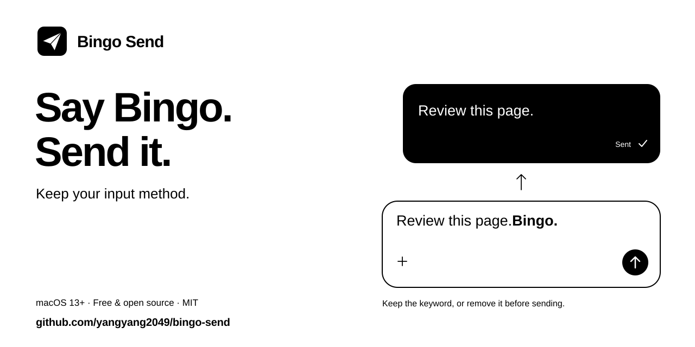

<p align="center">
  
</p>

<p align="center"><strong>Keep your favorite input method. End your message with “Bingo” to send it.</strong></p>

<p align="center">
  <a href="https://github.com/yangyang2049/bingo-send/releases/latest"></a>
  <a href="https://github.com/yangyang2049/bingo-send/actions/workflows/ci.yml"></a>
  <a href="docs/COMPATIBILITY.md"></a>
  <a href="LICENSE"></a>
</p>

<p align="center">
  <a href="https://github.com/yangyang2049/bingo-send/releases/download/v1.2.0/BingoSend-1.2.0-macOS-universal.dmg"></a>
</p>

<p align="center">
  <strong>English</strong> · <a href="README.zh-CN.md">简体中文</a> · <a href="docs/USER_GUIDE.md">User guide</a> · <a href="https://github.com/yangyang2049/bingo-send/releases/latest">All downloads</a>
</p>

Bingo Send is a standalone macOS menu bar app. It watches the focused editor in apps you enable, waits for text to settle, then triggers the configured send shortcut. **By default, your entire message and keyword stay unchanged.** You can optionally remove the final keyword before sending. No Skill or AI agent is needed.

```text
“Review this page, Bingo.” → text settles → sends “Review this page, Bingo.”
```

> **1.3.1 preview:** one run-mode selector—Paused / Test detection / Auto send—replaces the two overlapping switches. [Changes and test checklist](docs/RELEASE_NOTES_1.3.1.md). The stable download above remains 1.2.0 until the preview is released.

## Start in three steps

1. **Install.** Open the [universal DMG](https://github.com/yangyang2049/bingo-send/releases/download/v1.2.0/BingoSend-1.2.0-macOS-universal.dmg), drag Bingo Send into Applications, and open it. The package contains Apple Silicon and Intel binaries.
2. **Authorize and choose your setup.** Grant Accessibility permission in System Settings yourself. Choose an app or website from **App presets**, or add an app manually. For a website, select your browser and review the allowed domains and send shortcut; Codex defaults to **Return**.
3. **Set keywords and choose a mode.** Configure up to 3 final keywords. Choose **Test detection** for a sound without editing or sending; then choose **Auto send** for a separate send test. **Paused** stops observation. Every launch starts paused; saved keywords, app rules, and removal settings are retained.

The interface follows your system’s preferred language: English or Simplified Chinese, with English as the fallback.

## Small app, focused job

- **Your input method:** works on text after dictation, typing, or pasting.
- **Your keywords:** up to 3 at once, and any one of them at the end sends. Fresh installs are prefilled with three in the interface language—Bingo, Submit, Send, or 发送, 提交, 完成—and you can switch to a mixed set or write your own. Matching is case-insensitive and trailing spaces or punctuation are allowed. Stabilization delay: 0.5–3 seconds.
- **Keep or remove:** keep the keyword by default, or opt in to **Remove final keyword before sending**. Removal edits the focused draft and requires editor support; verify it separately in each app.
- **Your setup:** 13 opt-in app and website presets in one searchable list, plus manual app selection. Web presets preserve existing allowed domains; all enabled sites in one browser share its Return / ⌘ Return / ⌃ Return shortcut.
- **Your scope:** explicit app allowlist and browser domain restrictions. Presets help configure scope; each editor still needs its own detection and send test.
- **Local processing:** no recording, networking, saved drafts, or clipboard access. Default keep mode leaves text and selection untouched; optional removal edits only the matched final keyword and following punctuation or whitespace. [Privacy →](docs/PRIVACY.md)

## Compatibility

**Codex was user-tested successfully with 1.1.0 in keep mode.** Version 1.2.0 adds setup presets, keyword choices, optional removal, a new icon, and an English/Simplified Chinese interface; see its [release notes](docs/RELEASE_NOTES_1.2.0.md) for verification status. Other apps and websites—including Claude, Gemini, Grok, WorkBuddy, DeepSeek, Kimi, and HuggingChat—**still need separate validation**. Keep mode and removal mode need separate tests. A preset or allowlist entry is not a compatibility guarantee. Terminal CLI tools are outside the preset coverage. [Compatibility details →](docs/COMPATIBILITY.md)

<details>
<summary>Before you install: permissions and limitations</summary>

- Packages are **ad-hoc signed, not Apple notarized**. If macOS blocks opening, follow [Apple’s instructions](https://support.apple.com/102445). Accessibility access requires your manual approval.
- The project targets **macOS 13+**; the minimum OS and **Intel runtime have not been tested on physical devices**.
- Editors must expose readable Accessibility text and caret information. The caret must be at the end, with no selection.
- Optional keyword removal also requires editing support. If verification fails, sending stops; an interrupted removal may leave the draft or selection changed. Check the target input before trying again.
- Known browsers require domain restrictions. For an unrecognized browser, enable **Restrict by website domain** manually.
- Bingo Send **cannot stop your input method’s recording session**. It acts only after text appears; adjust the delay for continuous transcription.

</details>

## Build and contribute

Requires macOS and Swift 5.9+ (Xcode or Command Line Tools). No external dependencies.

```sh
swift test
./build.sh
# Universal build and release packages:
./build.sh --universal
./scripts/package-release.sh
```

Output: `build/Bingo Send.app`; packages: `dist/`.

[Contributing](CONTRIBUTING.md) · [Release guide](docs/RELEASING.md) · [Report an issue](https://github.com/yangyang2049/bingo-send/issues/new/choose)

Licensed under [MIT](LICENSE). Independent project; not affiliated with the input methods or AI products mentioned.
