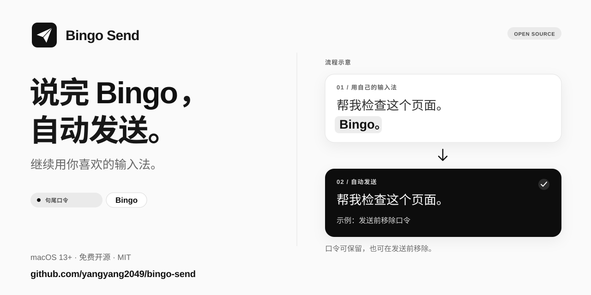

<p align="center">
  
</p>

<p align="center"><strong>继续用你喜欢的输入法，句尾说声「Bingo」就发送。</strong></p>

<p align="center">
  <a href="https://github.com/yangyang2049/bingo-send/releases/latest"></a>
  <a href="https://github.com/yangyang2049/bingo-send/actions/workflows/ci.yml"></a>
  <a href="docs/COMPATIBILITY.zh-CN.md"></a>
  <a href="LICENSE"></a>
</p>

<p align="center">
  <a href="https://github.com/yangyang2049/bingo-send/releases/download/v1.1.1/BingoSend-1.1.1-macOS-universal.dmg"></a>
</p>

<p align="center">
  <a href="README.md">English</a> · <strong>简体中文</strong> · <a href="docs/USER_GUIDE.zh-CN.md">使用指南</a> · <a href="https://github.com/yangyang2049/bingo-send/releases/latest">全部下载</a>
</p>

Bingo Send 是一个独立的 macOS 菜单栏应用。在你启用的应用里，它检测当前输入框的句尾口令，等待文字稳定，再触发发送按键。**正文和 Bingo 全部原样保留。** 无需安装 Skill，也无需运行 AI Agent。

```text
「帮我检查这个页面，Bingo。」 → 等文字稳定 → 发送「帮我检查这个页面，Bingo。」
```

## 三步开始

1. **安装应用。** 打开 [1.1.1 通用 DMG](https://github.com/yangyang2049/bingo-send/releases/download/v1.1.1/BingoSend-1.1.1-macOS-universal.dmg)，把 Bingo Send 拖进「应用程序」，然后打开。安装包包含 Apple Silicon 与 Intel 两种架构。
2. **授权并选择应用。** 点「去授权…」，亲自在系统设置中开启辅助功能权限。启用目标应用，核对发送按键；Codex 默认 **Return**。浏览器请设置允许的网站域名。
3. **先检测，再发送。** 打开「启用口令发送」，保留默认的「只检测，不发送」试一条新内容；检测成功后，关闭「只检测，不发送」即可实际发送。**每次重新启动都从暂停状态开始。**

应用界面目前为**中文**，项目文档提供中英文版本。关掉设置窗口后，应用仍在菜单栏运行。

## 一个小工具，专心做好发送

- **沿用输入法：** 豆包等输入法完成文字上屏后即可检测，手动输入和粘贴也可触发。
- **自定义口令：** 默认 `Bingo`，忽略英文大小写，兼容句尾空白和标点；稳定等待时间可调为 0.5～3 秒。
- **按需启用：** 应用白名单、浏览器域名限制，支持 `Return`、`⌘ Return`、`⌃ Return`。
- **本地处理：** 不录音、不联网、不保存正文，不修改文字、选区或剪贴板。[隐私说明 →](docs/PRIVACY.zh-CN.md)

## 兼容情况

**1.1.0 已由用户在 Codex 实测自动发送成功。** 1.1.1 沿用其核心发送逻辑，通过了构建、签名和打包检查。WorkBuddy、DeepSeek、Hugging Face 等其他应用或网站**仍需逐个验证**；加入白名单不代表已兼容。[兼容性记录 →](docs/COMPATIBILITY.zh-CN.md)

<details>
<summary>安装前了解：权限与使用限制</summary>

- 当前安装包使用 **ad-hoc 临时签名，未经 Apple 公证**。如果 macOS 拦截打开，请按 [Apple 的说明](https://support.apple.com/102445)操作；辅助功能权限需要用户亲自授予。
- 项目面向 **macOS 13 及以上**；最低系统版本与 **Intel 运行兼容性尚未经过实机测试**。
- 输入框必须提供可读取的辅助功能文本和光标信息。光标须在末尾，且未选中文字。
- 已识别浏览器强制限制网站域名；未识别浏览器请手动开启「按网页域名限制」。
- Bingo Send **不能结束输入法的录音**，只能处理已经上屏的文字；连续转写时请调整等待时间。

</details>

## 构建与参与

需要 macOS 和 Swift 5.9+（Xcode 或 Command Line Tools），没有外部依赖。

```sh
swift test
./build.sh
# 构建通用版本并打包：
./build.sh --universal
./scripts/package-release.sh
```

应用输出为 `build/Bingo Send.app`，安装包输出到 `dist/`。

[贡献指南](CONTRIBUTING.zh-CN.md) · [发布指南](docs/RELEASING.zh-CN.md) · [反馈问题](https://github.com/yangyang2049/bingo-send/issues/new/choose)

采用 [MIT 许可证](LICENSE)。本项目为独立工具，与所提及的输入法和 AI 产品没有隶属关系。
