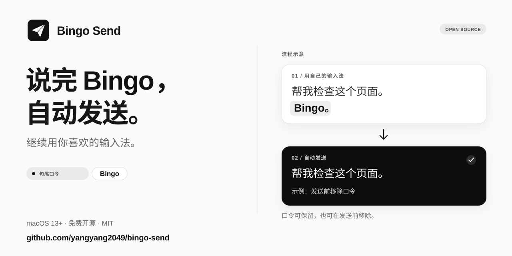

<p align="center">
  
</p>

<p align="center"><strong>继续用你喜欢的输入法，句尾说声「Bingo」就发送。</strong></p>

<p align="center">
  <a href="https://github.com/yangyang2049/bingo-send/releases/latest"></a>
  <a href="https://github.com/yangyang2049/bingo-send/actions/workflows/ci.yml"></a>
  <a href="docs/COMPATIBILITY.zh-CN.md"></a>
  <a href="LICENSE"></a>
</p>

<p align="center">
  <a href="https://github.com/yangyang2049/bingo-send/releases/download/v1.3.4/BingoSend-1.3.4-macOS-universal.dmg"></a>
</p>

<p align="center">
  <a href="README.md">English</a> · <strong>简体中文</strong> · <a href="docs/USER_GUIDE.zh-CN.md">使用指南</a> · <a href="https://github.com/yangyang2049/bingo-send/releases/latest">全部下载</a>
</p>

Bingo Send 是一个独立的 macOS 菜单栏应用。在你启用的应用里，它检测当前输入框的句尾口令，等待文字稳定，再触发发送按键。**默认原样保留正文和口令**，也可选择在发送前移除句尾口令。无需安装 Skill，也无需运行 AI Agent。

```text
「帮我检查这个页面，Bingo。」 → 等文字稳定 → 发送「帮我检查这个页面，Bingo。」
```

> **1.3.4：** 发送失败不再把「自动发送」切到「暂停」，后续新输入可继续处理，同一份失败草稿不会自动重试。同时包含最多三个口令、清晰的运行模式和首次授权引导。[发布说明](docs/RELEASE_NOTES_1.3.4.zh-CN.md)。

## 三步开始

1. **安装应用。** 打开 [1.3.4 通用 DMG](https://github.com/yangyang2049/bingo-send/releases/download/v1.3.4/BingoSend-1.3.4-macOS-universal.dmg)，把 Bingo Send 拖进「应用程序」，然后打开。安装包包含 Apple Silicon 与 Intel 两种架构。
2. **授权并选择配置。** 首次打开会自动申请辅助功能；请亲自在系统设置中允许。若没有提示，点「打开系统设置…」。授权成功后入口收进页面底部「权限与诊断」。从「应用预设」选择应用或网站，也可手动添加应用；网页版需选择浏览器、核对允许的域名与发送按键，Codex 默认 **Return**。
3. **设置口令并选择模式。** 配置最多 3 个句尾口令。「测试识别」只提示音、不修改、不发送；之后切到「自动发送」另做发送测试。「暂停」停止读取。每次启动均暂停，已有口令、应用规则和移除设置继续保留。

界面按系统首选语言自动使用英文或简体中文，其他语言回退英文。关掉设置窗口后，应用仍在菜单栏运行。

## 一个小工具，专心做好发送

- **沿用输入法：** 豆包等输入法完成文字上屏后即可检测，手动输入和粘贴也可触发。
- **选择口令：** 最多同时启用 3 个，句尾命中任意一个即发送。全新安装按界面语言预填三个：中文为 发送、提交、完成，其他语言为 Bingo、Submit、Send；可一键换用中英混用一组，也可逐行自定义。忽略大小写，兼容句尾空白和标点。稳定等待可调为 0.5～3 秒。
- **保留或移除：** 默认保留口令，也可主动开启「发送前移除句尾口令」。移除模式会修改聚焦草稿，要求编辑器支持，应在每个应用中单独验证。
- **快捷配置：** 13 个需主动添加的应用和网站预设统一列出并支持搜索，也可手动选择应用。网页预设保留已有允许域名；同一浏览器中的网站共用一个 `Return`、`⌘ Return` 或 `⌃ Return` 发送按键。
- **按需启用：** 应用白名单与浏览器域名限制；预设只帮助填写范围，每个编辑器仍需分别验证检测与发送。
- **本地处理：** 不录音、不联网、不保存正文、不读写剪贴板。默认保留模式不改文字和选区；可选移除模式仅删除匹配的句尾口令及其后的标点和空白。[隐私说明 →](docs/PRIVACY.zh-CN.md)

## 兼容情况

**1.3.4 在 Apple Silicon 上完成全新安装、辅助功能授权，用户确认日常使用正常。** 104 项自动测试通过；这不代表所有编辑器的移除口令和连续语音场景均已实测，额外的本地编辑器测试已按用户要求停止。保留与移除模式仍需按编辑器分别验证；提供预设或加入白名单不代表已兼容，终端 CLI 不包含在预设覆盖范围内。[兼容性记录 →](docs/COMPATIBILITY.zh-CN.md)

<details>
<summary>安装前了解：权限与使用限制</summary>

- 当前安装包使用 **ad-hoc 临时签名，未经 Apple 公证**。如果 macOS 拦截打开，请按 [Apple 的说明](https://support.apple.com/102445)操作；辅助功能权限需要用户亲自授予。
- 项目面向 **macOS 13 及以上**；最低系统版本与 **Intel 运行兼容性尚未经过实机测试**。
- 输入框必须提供可读取的辅助功能文本和光标信息。光标须在末尾，且未选中文字。
- 可选的口令移除还要求编辑器支持修改。核验失败会停止发送；移除中断可能留下已改草稿或选区，请检查原输入框后再试。
- 已识别浏览器强制限制网站域名；未识别浏览器请手动开启「按网页域名限制」。
- Bingo Send **不能结束输入法的录音**，只能处理已经上屏的文字；连续转写时请调整等待时间。

</details>

## 构建与参与

需要 macOS 和 Swift 5.9+（Xcode 或 Command Line Tools），没有外部依赖。

```sh
swift test
./build.sh
# 构建通用版本并打包：
./build.sh --universal
./scripts/package-release.sh
```

应用输出为 `build/Bingo Send.app`，安装包输出到 `dist/`。

[贡献指南](CONTRIBUTING.zh-CN.md) · [发布指南](docs/RELEASING.zh-CN.md) · [反馈问题](https://github.com/yangyang2049/bingo-send/issues/new/choose)

采用 [MIT 许可证](LICENSE)。本项目为独立工具，与所提及的输入法和 AI 产品没有隶属关系。
